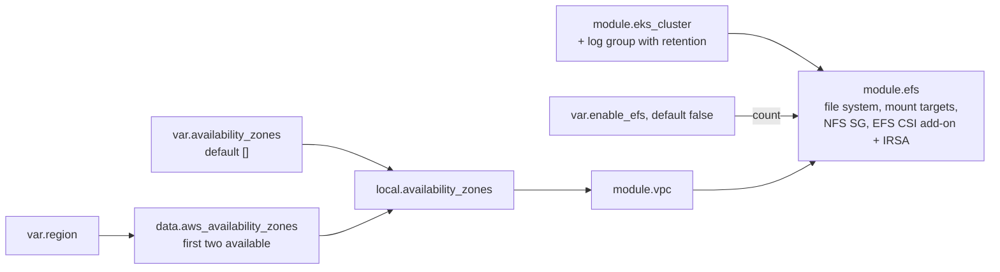

# Correctness fixes, round 2, part 1 — EKS platform

## Goal

After this part:
- the `eks/` stack applies in whatever region a learner sets;
- teardown leaves nothing billing;
- control-plane logs expire;
- the stack can create the EFS storage that GPU exercise 06 needs;
- its README stops teaching false facts about it;
- mock-provider tests that need no AWS account cover its Terraform behaviour.

It is the prerequisite for parts 2–4: `2026-10-09-correctness-fixes-round-2-2-core-exercises.md`, `2026-10-09-correctness-fixes-round-2-3-aws-exercises.md` and `2026-10-09-correctness-fixes-round-2-4-gpu-track.md`. The [research note](~/notes/research/2026-10-09-kubernetes-dojo-critical-analysis.md) explains why.

## Decision

This spec takes option A from the research's Recommendation:
1. Fix the P0/P1 defects and every false statement now.
2. Run the result on EKS before any part merges.
3. Then write the kind and CI spec that the 2026-09-14 specs deferred.

Rejected:
- **B (CI and kind first)** leaves the data-loss and cost defects in place while CI is built, and kind can't run the EKS-only steps.
- **Doing nothing** leaves every learner meeting the defects.

Choices made at interview (2026-10-09):
- **Scope:** the P0/P1 defects, plus every lower-severity item that is a failing step or a false statement. Version currency, drills, the kind move, CI and repo tidying go to later specs.
- **EFS** becomes an opt-in Terraform setting.
- **Teardown** gets a pre-destroy script.
- **GPU nodes:** each GPU exercise scales its own nodes up at the start and down at the end.

## Background

Read at `5119a98` on 2026-10-09.

- **No tests.**
  - `eks/` has no `*.tftest.hcl` file. The September specs checked Terraform with `terraform plan` against AWS (`docs/specs/2026-09-14-p0-p1-correctness-fixes-1-platform.md:66`).
  - A mock-provider suite run on a scratch copy at `5119a98` passed 17 runs, and five of them showed invalid inputs passing plan ([research](~/notes/research/2026-10-09-kubernetes-dojo-critical-analysis.md) [2]) *(unverified)*.
- **Region.** The quick start says "set your region at minimum" (`README.md:73`, also `eks/README.md:61`), and the example marks only `region` as required (`eks/terraform.tfvars.example:4-7`).
  - But `availability_zones` defaults to `eu-west-2a/b` and is checked only for length (`eks/variables.tf:32-41`), and it feeds every subnet (`eks/main.tf:8`, `eks/modules/vpc/subnets.tf:10`, `eks/modules/vpc/subnets.tf:29`). A mock plan with region `us-east-1` passes ([research](~/notes/research/2026-10-09-kubernetes-dojo-critical-analysis.md) [2]) *(unverified)*, so the apply fails at the subnets *(assumption: no apply was run)*.
  - Both subnet-count validations compare with `length(var.availability_zones)` (`eks/variables.tf:53-56`, `eks/variables.tf:69-72`).
  - There is no `region` output (`eks/outputs.tf:1-35`), so exercises hard-code the region, for example `exercises/13-vpc-networking/README.md:50`.
  - Since Terraform 1.9, a validation can refer to other variables ([changelog](https://github.com/hashicorp/terraform/blob/v1.9.0/CHANGELOG.md#L7), [research](~/notes/research/2026-10-09-kubernetes-dojo-critical-analysis.md) [3]) *(unverified)*. The repo requires 1.9.0 or later (`eks/versions.tf:2`).
- **Teardown.** Terraform manages no Kubernetes objects: there is no `kubernetes_` or `helm_` resource in `eks/`.
  - Exercise 05 creates a LoadBalancer Service (`exercises/05-services/manifests/loadbalancer-service.yaml:11`).
  - Exercise 07's class deletes a volume only when its PVC is deleted (`exercises/07-persistent-storage/manifests/storage-class.yaml:11`).
  - `README.md:262` says to delete the PVCs you "want to keep data from", which deletes that data.
  - `eks/README.md:222` says destroy deletes those volumes, but answer 12 at `eks/README.md:212` rightly says they're orphaned once the cluster is gone.
  - Left-over network interfaces block VPC deletion ([re:Post](https://repost.aws/knowledge-center/troubleshoot-dependency-error-delete-vpc), [research](~/notes/research/2026-10-09-kubernetes-dojo-critical-analysis.md) [4]) *(unverified)*.
- **Logs.**
  - All five log types are on (`eks/modules/eks_cluster/cluster.tf:59-67`), and nothing in `eks/` declares the log group, so EKS creates it, and its logs "never expire with the default retention policy" ([AWS blog](https://aws.amazon.com/blogs/containers/understanding-and-cost-optimizing-amazon-eks-control-plane-logs/), [research](~/notes/research/2026-10-09-kubernetes-dojo-critical-analysis.md) [5]) *(unverified)*.
  - Their cost row is still unmeasured (`README.md:240-243`).
  - Exercise 15 reads the audit stream (`exercises/15-eks-control-plane/README.md:157-159`).
- **EFS.**
  - GPU exercise 06 installs the driver with Helm (`gpu-ml/exercises/06-storage-for-ml/README.md:55-59`), and looks up a file system "created separately via Terraform or console" by a `cluster` tag (`gpu-ml/exercises/06-storage-for-ml/README.md:61-64`). Nothing in `eks/*.tf` creates one.
  - The driver needs an IAM role with `AmazonEFSCSIDriverPolicy` ([EFS CSI driver](https://docs.aws.amazon.com/eks/latest/userguide/efs-csi.html), [research](~/notes/research/2026-10-09-kubernetes-dojo-critical-analysis.md) [18]) *(unverified)*. The page's IRSA steps trust `system:serviceaccount:kube-system:efs-csi-*` with `StringLike` *(unverified: not in the note's text)*.
  - The `aws-efs-csi-driver` add-on is offered for 1.36, with v3.5.1 the default ([research](~/notes/research/2026-10-09-kubernetes-dojo-critical-analysis.md) [1]) *(unverified)*.
  - The EBS driver's IRSA wiring is the pattern to copy (`eks/modules/eks_cluster/data.tf:27-49`, `eks/modules/eks_cluster/iam.tf:28-38`, `eks/modules/eks_cluster/addons.tf:38-57`).
  - The exercise's class uses access points and `Retain` (`gpu-ml/exercises/06-storage-for-ml/manifests/efs-storageclass.yaml:7`, `gpu-ml/exercises/06-storage-for-ml/manifests/efs-storageclass.yaml:13`).
  - [DeleteFileSystem](https://docs.aws.amazon.com/efs/latest/ug/API_DeleteFileSystem.html) returns `FileSystemInUse` while mount targets exist *(unverified: not in the note)*.
- **False platform claims.**
  - **Add-on updates.** `eks/modules/eks_cluster/addons.tf:2` and `eks/README.md:152` say AWS patches the add-ons. But "Amazon EKS doesn't automatically update an add-on" ([EKS docs](https://docs.aws.amazon.com/eks/latest/userguide/updating-an-add-on.html), [research](~/notes/research/2026-10-09-kubernetes-dojo-critical-analysis.md) [10]) *(unverified)*, and no add-on sets `addon_version` (`eks/modules/eks_cluster/addons.tf:5-57`).
  - **Node role policies.** `eks/README.md:22` lists an EBS CSI policy on the node role, which `eks/modules/node_group/iam.tf:1-5` says is excluded.
  - **Overclaim.** `eks/README.md:3` calls the cluster "production-quality".
  - **Answer 4** (`eks/README.md:193`) requires the `kubernetes.io/cluster/<name>` subnet tag. Only "Version 2.1.1 or earlier of the AWS Load Balancer Controller requires this tag" ([EKS docs](https://docs.aws.amazon.com/eks/latest/userguide/network-reqs.html), [research](~/notes/research/2026-10-09-kubernetes-dojo-critical-analysis.md) [21]) *(unverified)*.
  - **Answer 8** (`eks/README.md:201`) says deleting `aws-auth` makes nodes `NotReady`. The cluster uses `API_AND_CONFIG_MAP` (`eks/modules/eks_cluster/cluster.tf:41-44`); EKS creates access entries for managed node group roles ([access entries](https://docs.aws.amazon.com/eks/latest/userguide/creating-access-entries.html), [research](~/notes/research/2026-10-09-kubernetes-dojo-critical-analysis.md) [24]) *(unverified)*; and "The aws-auth ConfigMap is deprecated" ([research](~/notes/research/2026-10-09-kubernetes-dojo-critical-analysis.md) [23]) *(unverified)*.
  - **Answer 9** (`eks/README.md:203`) quotes `no volumes plugin matched` for a CSI-backed PVC with no driver. A PVC like that waits on its external provisioner instead *(assumption)*.
  - **Answer 10** (`eks/README.md:205`) says counts change only through Terraform, but Terraform ignores `desired_size` (`eks/modules/node_group/node_group.tf:85-89`).
  - **Autoscaler tags.** Both answer 10 and `eks/README.md:154` imply that the Cluster Autoscaler reads the node group's tags (`eks/modules/node_group/node_group.tf:91-94`). In fact EKS "tags managed node group resources so that they are configured to use the Kubernetes Cluster Autoscaler" ([EKS docs](https://docs.aws.amazon.com/eks/latest/userguide/managed-node-groups.html), [research](~/notes/research/2026-10-09-kubernetes-dojo-critical-analysis.md) [7]) *(unverified)*.
  - **Answer 3** (`eks/README.md:191`) describes the control-plane ENIs as having an "amazon-eks owner description" *(unverified)*.

## Non-goals

- A single-NAT option, T3 credit settings, and the endpoint's `0.0.0.0/0` default.
- Provider tidy-up: the unbounded AWS constraint, the unused `kubernetes` provider and the thumbprint (`eks/versions.tf:5-16`).
- Pinning add-on and node-group versions.
- The other inputs that pass plan but fail at apply: subnets outside `vpc_cidr`, min greater than desired, and a GPU group keyed `general` (Background, "No tests").
- Regenerating `architecture.svg`, and tidying `reports/` and `docs/specs/`.
- Moving exercises 01–12 to kind, and CI. Both go in a later spec, whose CI will run W1's tests.

## Design

- **Tests.** `eks/tests/` holds one `.tftest.hcl` per concern. Mock values are shared through `mock_provider "aws" { source = "./tests/mocks/aws" }`, and the same for `tls`.
  - Root runs assert on validations (`expect_failures`), root locals and outputs. A run with `module { source = "./modules/<name>" }` asserts on a module's own resources, so the tests add no test-only outputs.
  - **`tftest`** below means: run `terraform -chdir=eks init -backend=false` once, then `env -u AWS_PROFILE AWS_CONFIG_FILE=/dev/null AWS_SHARED_CREDENTIALS_FILE=/dev/null terraform -chdir=eks test`.
  - A scratch prototype of W1, W2, W4 and W5 at `5119a98` ran these tests on Terraform 1.16.0. Each new file failed before its change, and all 17 runs passed after them. The Done when items quote its pass counts and errors *(assumption: an unrecorded scratch run)*.
- **Zones.** An empty `availability_zones` means the first two available zones that need no opt-in, sorted by name. An explicit list must have two or more entries, all in `var.region`.
- **Pre-destroy.** `eks/pre-destroy.sh` refuses to run unless the current kube context's server equals the `cluster_endpoint` output. It then deletes what made AWS resources (W3), and waits for AWS to release them.
- **EFS.** It is a separate module, so `count` turns it on and off as a unit. `terraform destroy`, or `enable_efs = false`, removes the mount targets first, then the file system.
- **Round-2 EKS run.** It runs once all four parts pass their static, mock and kind checks, and before any part merges. Budget a working day of about eight hours, with the cluster destroyed at the end: about $0.32/h for the base cluster (the `README.md:241` total ÷ 730), plus $0.615 per GPU node-hour ([research](~/notes/research/2026-10-09-kubernetes-dojo-critical-analysis.md) [6]) *(unverified)*. Eight hours with about five GPU node-hours is 8 × 0.32 + 5 × 0.615 ≈ $5.60, so budget $5–10, as the research's Cost estimate does *(estimate)*.
  1. Check that the G and VT quota covers 8 vCPUs, using the September part 1 S3 commands (`docs/specs/2026-09-14-p0-p1-correctness-fixes-1-platform.md:224-228`).
  2. In a shell with `AWS_REGION` unset, note the time, then apply with `enable_efs = true` and `gpu_node_groups = { gpu = { instance_types = ["g4dn.xlarge"] } }`.
  3. Run this part's checks, then each "Round-2 EKS run:" check of parts 2, 3 and 4, in that order.
  4. Run the two September items still waiting on an EKS run: the policy probe and the log-volume measurement (`docs/specs/2026-09-14-p0-p1-correctness-fixes-1-platform.md:70-75`). The measurement fills in `README.md:240-241`. September's step 5 (`docs/specs/2026-09-14-p0-p1-correctness-fixes-1-platform.md:76`) ends by deleting the log group by hand; it is replaced by steps 5–6 here, because W4 puts the log group under Terraform.
  5. With exercise 05's LoadBalancer Service, exercise 07's PVC and exercise 06's EFS PVC applied, run `eks/pre-destroy.sh`, then `terraform -chdir=eks destroy`.
  6. **Leftovers check.** Each command must print nothing:
     - `aws ec2 describe-volumes --region eu-west-2 --filters Name=tag-key,Values=kubernetes.io/created-for/pvc/name --query 'Volumes[].VolumeId' --output text` *(assumption: the EBS CSI driver sets that tag)*;
     - `aws efs describe-file-systems --region eu-west-2 --query "FileSystems[?Name=='k8s-dojo-efs'].FileSystemId" --output text`;
     - `aws logs describe-log-groups --region eu-west-2 --log-group-name-prefix /aws/eks/k8s-dojo/ --query 'logGroups[].logGroupName' --output text`.

     A load balancer or ENI left in the VPC would have made the destroy fail. If the log-group query lists the group, EKS re-created it during the deletion (spike 2). Delete it with `aws logs delete-log-group --region eu-west-2 --log-group-name /aws/eks/k8s-dojo/cluster`, and note that in the record.
  7. Record the results in `docs/specs/records/2026-10-09-correctness-fixes-round-2-1-platform-record.md`.

## Work items

### W1: Mock-provider test harness

- **Change:**
  - **Mocks.** `aws.tfmock.hcl` gives realistic shapes to what the configuration reads:
    - a launch template ID and version;
    - IAM role and OIDC provider ARNs in a placeholder account;
    - the cluster's OIDC issuer URL and CA data;
    - a minimal `aws_iam_policy_document` JSON;
    - the zones `eu-west-2a`, `eu-west-2b` and `eu-west-2c`.

    `tls.tfmock.hcl` gives one certificate with a SHA-1 fingerprint, for the OIDC thumbprint.
  - **`defaults.tftest.hcl`** tests behaviour that holds at `5119a98`, one run each:
    1. the default config creates no GPU group, and the general role is `k8s-dojo-node-group-role`;
    2. a group keyed `gpu` gets `k8s-dojo-gpu-node-group-role`;
    3. `modules/node_group` passes `ami_type`, `labels` and `taints` through;
    4. one zone is rejected (`eks/variables.tf:37-40`);
    5. a mismatched subnet count is rejected (`eks/variables.tf:53-56`);
    6. a bad VPC CIDR is rejected (`eks/variables.tf:26-29`);
    7. a lowercase capacity type is rejected (`eks/variables.tf:112-115`);
    8. a Kubernetes-style taint effect is rejected (`eks/variables.tf:153-160`).
  - **README.** Add the full command to `eks/README.md`: `terraform -chdir=eks init -backend=false`, then `env -u AWS_PROFILE AWS_CONFIG_FILE=/dev/null AWS_SHARED_CREDENTIALS_FILE=/dev/null terraform -chdir=eks test`. `tftest` is only this spec's shorthand for it.
- **Files:**
  - `eks/tests/defaults.tftest.hcl` (new)
  - `eks/tests/mocks/aws/aws.tfmock.hcl` (new)
  - `eks/tests/mocks/tls/tls.tfmock.hcl` (new)
  - `eks/README.md`
- **Done when:** `tftest -filter=tests/defaults.tftest.hcl` prints `Success! 8 passed, 0 failed.`, one for each run above.

### W2: Zones that follow the region, and a `region` output

- **Change:**
  - **Variable.** `availability_zones` defaults to `[]`.
  - **Lookup.** A root `data "aws_availability_zones" "available"` (`state = "available"`, `opt-in-status` `opt-in-not-required`) feeds `local.availability_zones`, which `eks/main.tf:8` passes to the VPC module.
    - A `lifecycle { postcondition { condition = length(self.names) >= 2 } }` on the data source fails with a clear message in a region with fewer zones than that.
    - The local takes `slice(sort(…names), 0, min(2, length(…names)))`, so the postcondition, not an index error, reports it.
  - **Validations.**
    - An explicit list needs two or more entries, each starting with `var.region`.
    - Both subnet-count checks compare with the number of zones in use: the length of `var.availability_zones`, or 2 when it's empty. They don't read the derived local.
  - **Output.** `output "region"` (new).
  - **Docs.** `eks/terraform.tfvars.example:16` and `eks/README.md:134` describe the derived default.
  - **Tests.** `region.tftest.hcl` (new) covers four cases:
    - the London default derives `eu-west-2a/b`;
    - `us-east-1`, with mocked zones, derives `us-east-1a/b` and `output.region` is `us-east-1`;
    - explicit `eu-west-2` zones under `us-east-1` are rejected;
    - a mocked one-zone region fails the postcondition (`expect_failures = [data.aws_availability_zones.available]`).
- **Files:**
  - `eks/variables.tf`
  - `eks/main.tf`
  - `eks/outputs.tf`
  - `eks/terraform.tfvars.example`
  - `eks/README.md`
  - `eks/tests/region.tftest.hcl` (new)
  - `eks/tests/mocks/aws/aws.tfmock.hcl`
- **Done when:**
  - Before the change, with only W1's and W2's test files in `eks/tests/`, `tftest -filter=tests/region.tftest.hcl` fails with `Reference to undeclared local value`. After it, it prints `Success! 4 passed, 0 failed.`
  - The `defaults` file still passes, and `terraform -chdir=eks validate` prints `Success! The configuration is valid.`
  - Round-2 EKS run: with `AWS_REGION` unset, `terraform -chdir=eks output -raw region` prints `eu-west-2`.

### W3: Pre-destroy script and correct destroy steps

- **Change:**
  - **Script.** `eks/pre-destroy.sh` (new, executable) does the following, in order:
    1. Reads `cluster_name`, `cluster_endpoint` and `region` (W2) with `terraform output`. It exits 1, before any delete, unless the current kube context's server equals the endpoint.
    2. Asks the learner to type the cluster name, unless `--yes` is passed.
    3. Deletes every namespace except `default`, `kube-system`, `kube-public` and `kube-node-lease`; then the Deployments, StatefulSets, DaemonSets, Jobs, CronJobs and Pods in `default`; then every remaining LoadBalancer Service and PVC.
    4. Waits up to 15 minutes until no LoadBalancer Service remains, and no PV whose `spec.persistentVolumeReclaimPolicy` is `Delete`. (`reclaimPolicy` is the StorageClass's field, `exercises/07-persistent-storage/manifests/storage-class.yaml:11`.)
    5. For each remaining PV whose driver is `efs.csi.aws.com`, deletes the access point named in its `volumeHandle` (`<file system>::<access point>`) with `aws efs delete-access-point`, then deletes the PV *(assumption: the handle's format for `efs-ap` volumes; spike 3)*. It lists any other `Retain` PV with its volume handle.
  - **Docs.** `README.md:253-262` and `eks/README.md:216-222` run the script before `terraform destroy`.
    - They say what is actually true: deleting a PVC under `reclaimPolicy: Delete` deletes its data, so snapshot it to keep it; and destroying first orphans the volumes.
    - After destroy, delete `/aws/eks/<cluster>/cluster` if `aws logs describe-log-groups` still lists it.
- **Files:** `eks/pre-destroy.sh` (new), `README.md`, `eks/README.md`
- **Done when:**
  - `bash -n eks/pre-destroy.sh` exits 0.
  - **Guard test.** A prototype showed this works *(assumption: an unrecorded scratch run)*. In a scratch copy, set up:
    - a `terraform.tfstate` whose `cluster_endpoint` output is `https://ABC.gr7.eu-west-2.eks.amazonaws.com`;
    - `KUBECONFIG` pointing at a context whose server is `https://other.example.com`;
    - `kubectl` wrapped to log its arguments.

    Then `./pre-destroy.sh --yes` exits 1, and the log holds only `kubectl config view …`.
  - `grep -n 'keep data from' README.md` and `grep -n 'and the EBS volumes for any' eks/README.md` print nothing.
  - `grep -n 'pre-destroy.sh' README.md eks/README.md` prints a line in each file's destroy section.
  - Round-2 EKS run:
    - the script exits 0, and the destroy and the leftovers check pass (Design, steps 5–6). The leftovers check's EBS query is the backstop if the PV wait returns early.
    - with exercise 06's StorageClass applied in its `5119a98` form (`Retain`) and its PVC bound, the script deletes the access point, and `aws efs describe-access-points --file-system-id "$(terraform -chdir=eks output -raw efs_file_system_id)" --query 'length(AccessPoints)'` prints `0`.

### W4: Control-plane log group with retention

- **Change:**
  - **Log group.** `aws_cloudwatch_log_group.cluster` (`/aws/eks/${var.cluster_name}/cluster`) goes in `eks/modules/eks_cluster/cluster.tf`, with `retention_in_days = var.cluster_log_retention_days`. `aws_eks_cluster.this` depends on it (`eks/modules/eks_cluster/cluster.tf:71-74`), so it's created first and destroyed last.
  - **Variable.** `cluster_log_retention_days` (new) has a default of 7 and accepts only the values CloudWatch accepts. It's declared in the root and in the module, and passed through in `eks/main.tf`. The log types are unchanged.
  - **Docs.**
    - `README.md:243` says the logs now expire.
    - `eks/README.md:151` and the variables table are updated.
    - "Existing clusters" (`eks/README.md:224-228`) adds a step before the first apply after this change: `terraform -chdir=eks import module.eks_cluster.aws_cloudwatch_log_group.cluster /aws/eks/<cluster>/cluster`.
- **Files:**
  - `eks/modules/eks_cluster/cluster.tf`
  - `eks/modules/eks_cluster/variables.tf`
  - `eks/variables.tf`
  - `eks/main.tf`
  - `README.md`
  - `eks/README.md`
  - `eks/tests/logs.tftest.hcl` (new)
- **Done when:**
  - Before the change, `tftest -filter=tests/logs.tftest.hcl` fails with `Reference to undeclared resource`. After it, it prints `Success! 2 passed, 0 failed.` The module run checks the name, the retention of 7 and that `audit` stays on; a root run rejects `8`.
  - Round-2 EKS run: `aws logs describe-log-groups --region eu-west-2 --log-group-name-prefix /aws/eks/k8s-dojo/cluster --query 'logGroups[0].retentionInDays'` prints `7`.

### W5: Opt-in EFS for GPU exercise 06

- **Change:**
  - **Module.** `eks/modules/efs/` (new) is called from `eks/main.tf` with `count = var.enable_efs ? 1 : 0` and `depends_on = [module.node_group]`. It creates:
    - an encrypted file system named `<cluster>-efs`;
    - a security group whose one rule allows TCP 2049 from `var.vpc_cidr`, the address range of both the nodes and the pods *(assumption: the CSI node plugin mounts from the node's address)*;
    - one mount target per private subnet, using `count`, because subnet IDs are unknown at plan;
    - an IRSA role trusting `system:serviceaccount:kube-system:efs-csi-*` (`StringLike`) and the `sts.amazonaws.com` audience, with `arn:aws:iam::aws:policy/service-role/AmazonEFSCSIDriverPolicy` attached;
    - the `aws-efs-csi-driver` add-on with that role, after the mount targets.
  - **Module inputs.**
    - `cluster_name`, plus `vpc_id`, `vpc_cidr` and `private_subnet_ids` from `module.vpc` (`eks/modules/vpc/outputs.tf:1-19`).
    - `oidc_provider_arn` and `oidc_provider_url` from `module.eks_cluster` (`eks/modules/eks_cluster/outputs.tf:27-35`).
    - The module-level `depends_on` defers its data source, the trust-policy document, to apply time; that is accepted.
  - **Fallback.** If spike 6 shows the add-on puts the role on the controller's service account only, narrow the trust to `efs-csi-controller-sa` with `StringEquals`, as the EBS role does (`eks/modules/eks_cluster/data.tf:27-49`).
  - **Root.** `enable_efs` (new, default `false`) and `output "efs_file_system_id"` (new), which is `one(module.efs[*].file_system_id)` and so null when EFS is off. Exercise 06 finds the file system through this output: part 4 W3 replaces its `cluster`-tag lookup (`gpu-ml/exercises/06-storage-for-ml/README.md:61-64`), so the file system needs no `cluster` tag.
  - **Docs.** The variables table, a short EFS note in `eks/README.md`, and a commented line in the tfvars example.
- **Files:**
  - `eks/modules/efs/main.tf` (new)
  - `eks/modules/efs/variables.tf` (new)
  - `eks/modules/efs/outputs.tf` (new)
  - `eks/main.tf`
  - `eks/variables.tf`
  - `eks/outputs.tf`
  - `eks/terraform.tfvars.example`
  - `eks/README.md`
  - `eks/tests/efs.tftest.hcl` (new)
- **Done when:**
  - Before the change, `terraform -chdir=eks init -backend=false` fails with `Unreadable module directory`, because the test's `module` block names `./modules/efs`; until the module exists, no file in `eks/tests/` runs. After it, `tftest -filter=tests/efs.tftest.hcl` prints `Success! 3 passed, 0 failed.`:
    - EFS is off by default, and the output is null;
    - `enable_efs = true` creates the module and a non-null ID, in a mocked apply;
    - the module run sees encryption, two mount targets, the 2049 rule from the VPC CIDR only, and the add-on.
  - Round-2 EKS run:
    - `aws eks describe-addon --cluster-name k8s-dojo --addon-name aws-efs-csi-driver --region eu-west-2 --query addon.status` prints `"ACTIVE"`;
    - part 4's exercise 06 PVC binds;
    - after an apply with `enable_efs = false`, the Design step 6 EFS query prints nothing.

### W6: Correct the platform's false claims

- **Change** (in `eks/README.md` and `eks/modules/eks_cluster/addons.tf:2`):
  - **Add-ons.** EKS doesn't update add-ons by itself; each stays at the version EKS chose when it was created.
  - **`eks/README.md:22`.** Drop the EBS CSI policy.
  - **`eks/README.md:3`.** "a learning cluster", not "production-quality".
  - **Answer 4.** The role tags select load-balancer subnets. The cluster tag matters only to Load Balancer Controller 2.1.1 or earlier.
  - **Answer 8.** Managed node groups authenticate through access entries, so deleting `aws-auth` removes only hand-added mappings, and `aws-auth` is deprecated.
  - **Answer 9.** Quote the event text from the kind check below.
  - **Answer 10 and `eks/README.md:154`.** EKS tags the Auto Scaling group for the Cluster Autoscaler, and counts also change with `aws eks update-nodegroup-config`.
  - **Answer 3.** Use the description that the EKS run shows.
- **Files:** `eks/README.md`, `eks/modules/eks_cluster/addons.tf`
- **Done when:**
  - `git grep -n 'auto-patched\|patched and updated by AWS\|production-quality\|no volumes plugin matched\|only changed by Terraform' -- eks` prints nothing.
  - `grep -n 'EBS CSI policies' eks/README.md` prints nothing.
  - `grep -n -i 'access entr' eks/README.md` shows answer 8.
  - kind: create a PVC whose class names `ebs.csi.aws.com`, which has no driver on kind. The event text that answer 9 quotes appears verbatim in that PVC's `kubectl describe pvc` output.
  - Round-2 EKS run: the description that answer 3 quotes appears verbatim in the output of `aws ec2 describe-network-interfaces --region eu-west-2 --filters Name=vpc-id,Values=$(terraform -chdir=eks output -raw vpc_id) --query 'NetworkInterfaces[].Description'`.

## Effort

| Item | Estimate | Depends on |
|---|---|---|
| W1 | 1 h | — |
| W2 | 1.5 h | W1 |
| W3 | 2.5 h | W2 (the `region` output) |
| W4 | 1 h | W1 |
| W5 | 2–3 h | W1 |
| W6 | 1 h plus the kind check | — |
| Round-2 EKS run | a working day (about 8 h), about $5–10 (Design) | static, mock and kind checks of all four parts |

These estimates come from reading the code and from the scratch prototype (Design), not from doing the work, so trust the ordering more than the numbers.

## Spike questions

1. Are the first two available zones in eu-west-2 today's `eu-west-2a/b`, so a London cluster's plan shows no subnet change? Experiment: `aws ec2 describe-availability-zones --region eu-west-2 --filters Name=opt-in-status,Values=opt-in-not-required --query 'AvailabilityZones[].ZoneName'`, which is read-only and free.
   Open: needs AWS credentials, which the spike sandbox doesn't have; run the experiment by hand, or in the round-2 EKS run.
2. Does EKS re-create `/aws/eks/<cluster>/cluster` while the cluster is being deleted? Experiment: the leftovers check (Design, step 6).
   Open: needs a cluster being deleted; the round-2 EKS run's leftovers check answers it.
3. Do the access points that `efs-ap` creates block deleting the file system, given that the API reference names only mount targets? Experiment: after exercise 06 in the EKS run, apply `enable_efs = false`.
4. Does the import in W4 leave a clean plan? Experiment: in the EKS run, `terraform state rm` the log group, import it, and `terraform -chdir=eks plan` shows no changes.
   Open: needs the round-2 EKS run's cluster and its log group.
5. Is deleting a LoadBalancer Service held until AWS has deleted its load balancer, so W3's wait means the load balancer is gone? Experiment: in the EKS run, time the Service's deletion against `aws elbv2 describe-load-balancers`.
6. Does the `aws-efs-csi-driver` add-on put W5's role on both `efs-csi-controller-sa` and `efs-csi-node-sa`? Experiment: in the EKS run, `kubectl -n kube-system get sa efs-csi-controller-sa efs-csi-node-sa -o jsonpath='{range .items[*]}{.metadata.name}={.metadata.annotations.eks\.amazonaws\.com/role-arn}{"\n"}{end}'`. If only the controller's is set, use W5's fallback.
   Open: needs a cluster with the add-on installed; the round-2 EKS run answers it.

## Risks and rollback

- **Existing clusters** already have the log group, so the first apply after W4 fails until it's imported *(assumption)*. W4's docs cover this, and spike 4 checks it.
- **W2 changes a default.** A London cluster is unchanged if spike 1 holds. Explicit lists keep working, unless they name zones outside `region`, which could never have applied.
- **`pre-destroy.sh` is destructive** by design. The context check and the typed confirmation guard it.
- **Rollback.** Revert per work item.
  - W4: `terraform state rm` the log group first to keep it.
  - W5: apply `enable_efs = false` before reverting.

## Open questions

- The research note has no Verification table, so its borrowed claims stay *(unverified)* until `/research finish` checks them.
